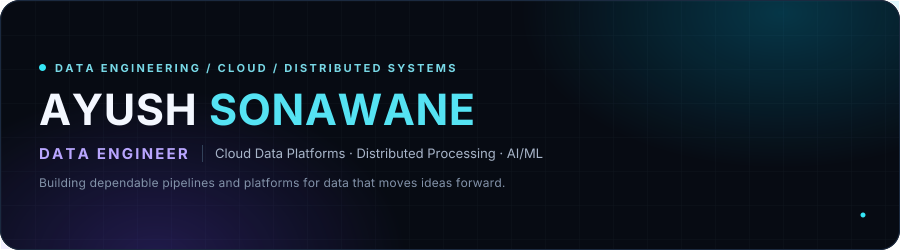
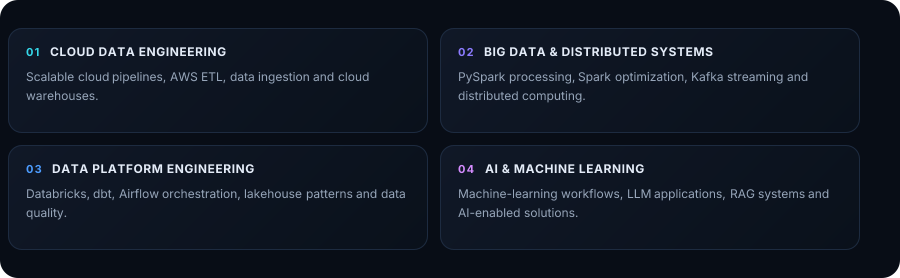
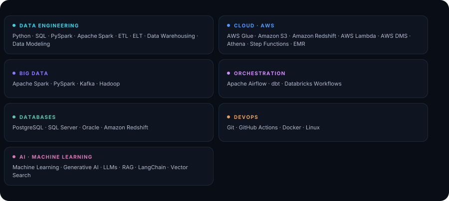
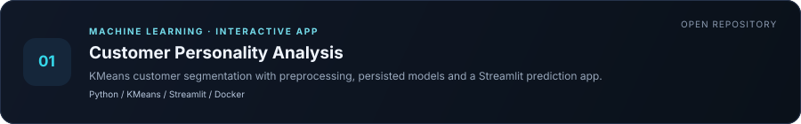
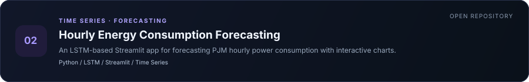
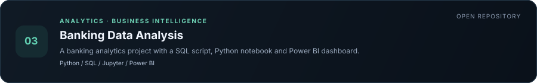
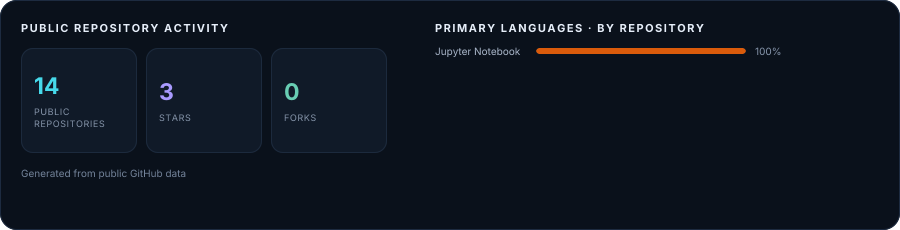

  

***

<a href="https://www.linkedin.com/in/ayush-sonawane1202/">LinkedIn</a>

## About

I’m a **Data Engineer** focused on scalable data pipelines, cloud data platforms, ETL workflows, warehouses, and distributed processing. My toolkit spans AWS, Python, SQL, PySpark, Spark, Databricks, dbt, Airflow, and Kafka; I also explore machine learning, generative AI, LLMs, and retrieval-augmented generation.

## Engineering focus

## Technology toolkit

Grouped by the work they support — not ranked by proficiency.

## Selected projects

Selected from public repositories; descriptions reflect their READMEs and checked-in files.

## GitHub snapshot

Repository metrics and primary-language mix below are generated from GitHub's API at build time. Language share is based on the primary language of each public repository, not lines of code. GitHub's live contribution graph remains available on the [profile activity page](https://github.com/Ayush-DataAnalyst).

***

  <strong>Building data systems. Exploring intelligent technologies. Engineering what comes next.</strong>

